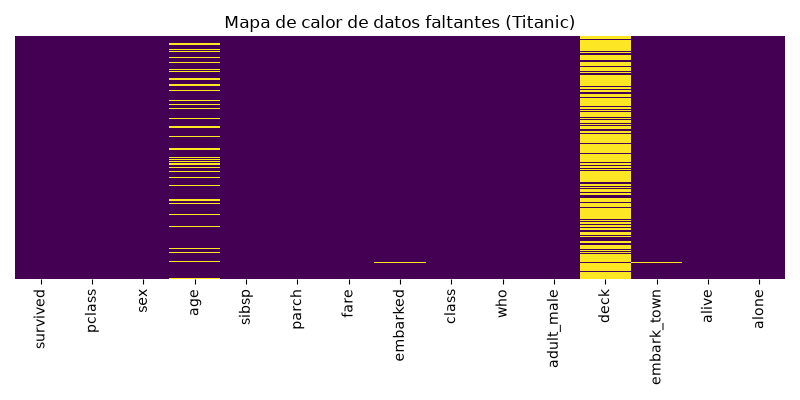
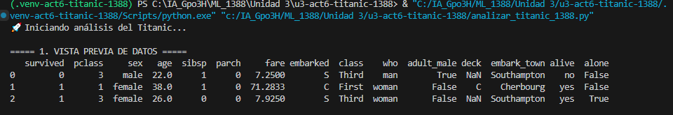
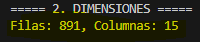
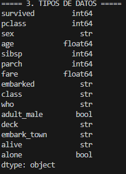
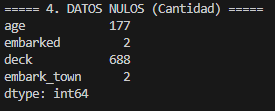
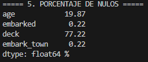
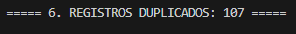
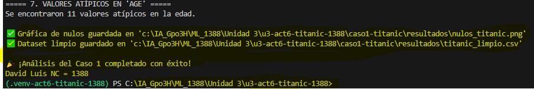

## Barrera Contreras Luis David
## Machine Learning
## link del archivo leeme-titanic-1388.md
## link del archivo pytnon p6-titanic-0777.py

# Titanic

# Nulos titanic

# 1. VISTA PREVIA DE DATOS

# 2. DIMENSIONES

# 3. TIPOS DE DATOS

# 4. DATOS NULOS (Cantidad)

# 5. PORCENTAJE DE NULOS

# 6. REGISTROS DUPLICADOS

# 7. VALORES ATÍPICOS EN 'AGE'
